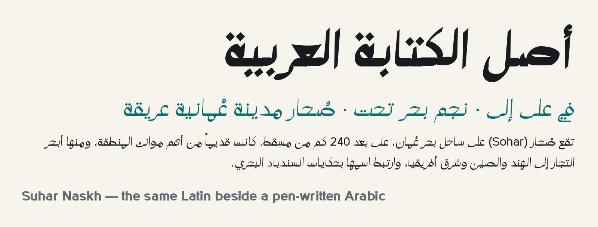
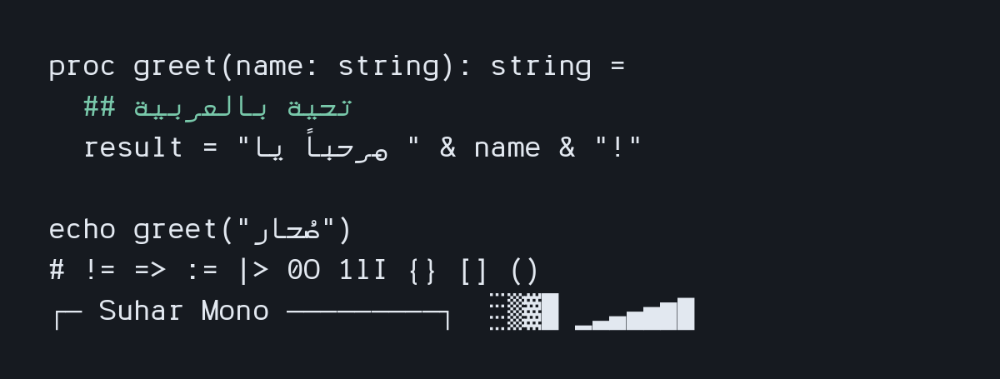

# Suhar  صُحار

**One typeface family for Arabic and Latin that looks like one design, from an 8‑pixel menu to a printed headline.**


Suhar is named after my home port: Suhar (Sohar), on the Batinah coast of Oman, the city the Sindbad
stories sail from. I started it as the interface font of [Retro Nim UI](https://github.com/foxoman/retroui)
and of my terminal editor ned, and it grew into a family for screens, bilingual signage and print.

- Designer: Sultan Al Isaiee ([@foxoman](https://github.com/foxoman), <https://www.foxoman.net>)
- Version 2.6 · SIL Open Font License 1.1
- Scripts: Latin (extended, Vietnamese, transliteration), Arabic (Arabic, Persian, Urdu, Kurdish, Pashto,
  Sindhi, Uyghur, Jawi, Quranic marks), Greek (monotonic and polytonic), Cyrillic, Hebrew with points
- 2,469 characters in Suhar, 13,064 in the Nerd builds

## Why I made it

Most bilingual interfaces pair a Latin font with an Arabic font drawn by someone else, at another size and
another weight. In Suhar both scripts come from the same pen and the same proportions, so a line that mixes
them keeps one colour and one height:


## The families

| Family | Use it for | Styles |
|---|---|---|
| **Suhar** | interfaces, text, signage | Light to Black, with italics (14) |
| **Suhar Condensed** | signs and tight headlines, about 15 % narrower | Light to ExtraBold, with italics (12) |
| **Suhar Naskh** | books, magazines, long Arabic text | Regular to Bold, with italics (8) |
| **Suhar Naskh Caption** | Naskh at 6 to 8 point | Regular to Bold, with italics (8) |
| **Suhar Naskh Display** | titles; joined words slope down to the left as in handwriting | Regular to Bold (4) |
| **Suhar Sahafa** | newspaper text: a low, wide Naskh with large open loops and a serif Latin | Regular to Bold, with italics (8) |
| **Suhar Sahafa Headline** | newspaper headlines: tighter, more contrast, deeper bowls | Regular to Bold, with italics (8) |
| **Suhar Sahafa Caption** | 6 to 8 point: thicker thin strokes, looser spacing, larger dots, marks further out | Regular to Bold, with italics (8) |
| **Suhar Typewriter** | typed letters and forms: one weight of line, slab serifs, filled corners | Regular, Bold, with italics (4) |
| **Suhar Mono** | code and terminals, 600‑unit cell | Light to ExtraBold, with italics (12) |
| **Suhar Nerd**, **Suhar Nerd Mono**, **Suhar Nerd Condensed**, **Suhar Nerd Sahafa**, **Suhar Nerd Sahafa Headline** | the same with the Nerd Fonts 3.5.1 icons | as their base family |
| **Suhar Pixel 8–13**, **Suhar Mono Pixel 12/14** | one exact pixel size each, no blur | Regular, Bold |

Variable fonts: `Suhar[opsz,wght]`, `SuharCondensed[opsz,wght]`, `SuharNaskh[GRAD,opsz,wght]`, `SuharNaskhDisplay[wght]`,
`SuharSahafa[GRAD,opsz,wght]`, `SuharSahafaHeadline[GRAD,opsz,wght]`, `SuharMono[wght]` and their italics
(weight 400–700, optical size 8–72, grade −50 to 50).



### Suhar Naskh

The Arabic of Suhar Naskh is written with a contrasted reed pen: a heavy baseline, lighter uprights, tails
that sweep to the left, pointed terminals and slanted rhombic dots. The Latin is the Latin of Suhar, so the two
families sit together on one page. In Suhar Naskh Display a joined word starts high on the right and lands on
the baseline at its last letter, final yeh returns under the word (في، على، إلى) and toothed letters stand on
ج ح خ (نجم، بحر، تحت).

### Suhar Sahafa


Suhar Sahafa (صحافة, the press) is the cut for body text: newspapers, magazines, long reading in small sizes.
That is its job, and the difference from Suhar. Its Arabic is shaped for the outline of the word. Alef and the
other stems stand above the Latin capitals, the loops of ص ض ط ف ق و م ه stay near the Latin x-height, and the
teeth have three heights: tall at the start of a word, lower inside it, and lowest in س ش, so that سـ and بتـ
are different shapes at a glance. The bowls go deep enough to be seen, the letters are set close, and the pen
has moderate contrast (the upright is about two thirds of the baseline stroke), so the thin strokes hold in
small sizes. The static fonts have small ink traps where a tooth or a stem meets the baseline. The Latin is a
sturdy serif with curved brackets, drawn with the same stem as the Arabic baseline stroke in every weight; the
italic has its own a, f, l, n and exit strokes. **Text** is the main cut, **Caption** is for 6 to 8 point, and
**Headline** is tighter, with more contrast, deeper bowls and filled corners.

What I measured against three well-known open Naskh faces, at the same point size:

| | loop of ص (per em) | alef (per em) | loop ÷ alef | length of the same line |
|---|---:|---:|---:|---:|
| Suhar Sahafa Text | 0.45 | 0.77 | 0.58 | 100 % |
| Noto Naskh Arabic | 0.36 | 0.67 | 0.53 | 101 % |
| Scheherazade New | 0.35 | 0.70 | 0.50 | 102 % |
| Amiri | 0.28 | 0.70 | 0.41 | 92 % |

So Sahafa still has the largest loops, sets about as much text on a line as Noto Naskh (101 % of its
length), and Amiri is the most economical (92 %). These are measurements of size and room, not of
reading. Traditional Arabic and Yakout are commercial fonts that I do not have, so I cannot put Sahafa beside
them; they are written Naskh hands and Sahafa is a constructed one, and I expect them to read more easily in long
text. `docs/images/sahafa-compare.png` shows one paragraph in Sahafa, Noto Naskh and Amiri.

### Sizes, paper and justification

- **Optical size.** The variable fonts of Suhar, Suhar Condensed, Suhar Naskh and Suhar Sahafa change with the
  size: at 8 point the thin strokes are thicker, the letters looser, the dots larger and the vowel marks
  further from the letter; at 72 point everything is finer and tighter. Browsers do this by themselves
  (`font-optical-sizing: auto`). Where a variable font cannot be used, Suhar Sahafa Caption is the 8-point cut as
  ordinary font files.
- **Grade.** The Suhar Sahafa and Suhar Naskh variable fonts have a grade axis: −50 for paper that spreads ink, +50 for coated paper
  and toner. A grade changes the stroke and nothing else, so the text does not reflow:
  `font-variation-settings: "GRAD" -50`.
- **Neighbour forms.** In the Naskh and Sahafa families some letters change with their neighbour, on by default
  (`calt`): a tooth before final ر ز is narrower and the ر starts at once (بر، تبرير); a tooth before final ن ي is
  raised (بين، نبي); ك before ا ل is narrower (كال، كل); final ي returns under ف ق (في); and in Sahafa ل stands on a
  following م (لمس، المجلس).
- **Justification.** `jalt` gives final and isolated ب ت ث ف ك a body that is 40 % longer; tatweel (ـ) joins
  inside any word. Where a kashida may go is written down as code: `tools/kashida.py` justifies lines with it,
  and `site/kashida.js` does the same in a web page.
- **Word space.** An Arabic word ends about 50 units closer to the space than a Latin word, and a word that
  starts with ا stands a little closer still; `reports/word-spacing.md` has the measurements for every style.
- **Print proof.** [`docs/Suhar-print-proof.pdf`](docs/Suhar-print-proof.pdf) sets every family from 6 to 48 point,
  newspaper columns, the optical sizes, the grades, reversed text and the ink traps, with a list of what to
  look for. Print it at 100 % on your own printer; that is the test I cannot run.

### Web, npm and specimens

- `site/index.html` is a one-page specimen with live size, weight, optical size and grade sliders, a newspaper
  column and the kashida switch. With GitHub Pages serving the repository it is at `/site/`.
- `python tools/make_npm.py && cd build/npm/package && npm publish` publishes the web fonts as `@foxoman/suhar`
  (one CSS file per family).
- [`docs/Suhar-specimen.pdf`](docs/Suhar-specimen.pdf) is a four-page specimen for printers and publishers.
- `reports/fontbakery.md` is what Fontbakery's universal checks say about one font of each family.

### Suhar Mono



Every character takes one cell, Arabic included, so columns stay aligned in a terminal. Box drawing, blocks,
Braille and Powerline symbols are built on the cell and join without gaps. Code ligatures (`!=`, `=>`, `:=`,
`|>` …) are optional.

## What is inside

- **Arabic that is shaped properly**: all joining forms, lam‑alef, marks placed by anchors, kerning after
  ر ز و and against the space so words are evenly spaced, tall‑tooth alternates in long runs of teeth,
  Urdu figure forms, numbers set inside the end‑of‑ayah sign ۝.
- **The Omani rial sign** (U+20C4) from the Central Bank of Oman's own outline, with the Saudi riyal and
  UAE dirham signs.
- **An Omani touch you can switch on**: khanjar tails on y g j Q and ر ز و (`ss01`), the khanjar and crossed
  swords, a dhow, a fort, a dallah, a frankincense burner and wayfinding pictograms (U+E100–E148).
- **Typography**: small capitals, old‑style and proportional figures, fractions, superscripts and
  subscripts, slashed, dotted or plain zero.
- **Hinting** for small sizes in every static font, and hand‑drawn Arabic bitmaps in Suhar Pixel 8, 9 and 10.

| Feature | Tag |
|---|---|
| Khanjar tails | `ss01` |
| Dotted / plain / slashed zero | `ss02` / `ss03` / `zero` |
| Two‑cell ص ض س ش in Suhar Mono (editors that place glyphs by their width) | `ss05` |
| Returning yeh in Suhar Naskh | `ss06` |
| Letters standing on ج ح خ in Suhar Naskh | `ss07` |
| Arabic ligatures لم لمح لح في الله, code ligatures in Mono | `dlig` |
| Small capitals | `smcp`, `c2sc` |
| Old‑style, lining, proportional, tabular figures | `onum`, `lnum`, `pnum`, `tnum` |
| Fractions, superscript, subscript, ordinals | `frac`, `sups`, `subs`, `ordn` |

## Install

Download a release, or take the files from `dist/` in this repository.

| System | Steps |
|---|---|
| **Windows** | Select the `.ttf` files in `ttf/`, right‑click, *Install for all users*. |
| **macOS** | Open the `.ttf` files with Font Book and press *Install*. |
| **Linux** | `mkdir -p ~/.local/share/fonts/suhar && cp ttf/*.ttf ~/.local/share/fonts/suhar/ && fc-cache -f` |
| **Termux** | `cp SuharNerdMono-Regular.ttf ~/.termux/font.ttf && termux-reload-settings` |
| **Android app** | Put the `.ttf` in `res/font/`, or load it with `Typeface.createFromFile`. |
| **Web** | Use the files in `woff2/` (see below). |

Install either the static fonts or the variable fonts of a family, not both: they share their names.

```css
@font-face {
  font-family: "Suhar";
  src: url("Suhar[opsz,wght].woff2") format("woff2");
  font-weight: 400 700;
}
body { font-family: "Suhar", system-ui, sans-serif; }
h1:lang(ar) { font-family: "Suhar Naskh Display", "Suhar", serif; }
.news     { font-family: "Suhar Sahafa", serif; }
.news h2  { font-family: "Suhar Sahafa Headline", serif; }
.price { font-feature-settings: "tnum"; }
```

`specimen/device-test/index.html` is a one‑page check list: open it on a phone or a browser and it tells you
what a correct result looks like for joins, kerning, the sloping Naskh, the rial sign and the Mono grid.

### Retro Nim UI

```nim
import retroui, suhar

useSuhar()            # or useSuharMono(), useSuharNaskh()
app "Hello", 320, 120:
  label "Suhar  صُحار  " & icon(siDhow) & "  " & OmaniRialSign & " 1.500"
```

The module is in `nim/`; it embeds the fonts at compile time. See `nim/README.md`.

## Build it yourself

The fonts are not drawn in a font editor. Every glyph is a skeleton written in a small text language and
expanded by a pen, so a weight, a width or a new family is a change of parameters.

```sh
python -m pip install -r requirements.txt
cd src && python -m retrofont.build --out ../dist     # every font; about an hour on two cores
cd .. && python tools/validate.py                     # the checks, reports/validation.md
python tools/make_docs.py                             # coverage tables, specimen, glyph catalogue
```

`--only Sans-Regular,Mono-Bold` builds single styles; `--no-nerd` and `--no-vf` skip those steps.
`tools/finish.sh` runs everything in order.

| Path | Content |
|---|---|
| `src/retrofont/` | the generator: `engine.py` (skeleton language and pen), `latin*.py`, `arabic.py`, `greek_cyrillic.py`, `more_scripts.py`, `symbols.py`, `terminal.py`, `sahafa.py`, `kern.py`, `features.py`, `pixel.py`, `pixel_arabic.py`, `nerd.py`, `build.py` |
| `dist/` | the built fonts: `ttf/`, `woff2/`, `variable/`, `pixel/` (OpenType/CFF files, the Nerd builds and the UFO masters are in the release archives) |
| `tools/` | validation, documentation, proof renderer (HarfBuzz and FreeType), word spacing, print proof |
| `docs/` | design notes, coverage, icons, licensing, limitations, glyph catalogue |
| `reports/` | the validation report and rendered proofs |
| `specimen/` | HTML specimen and the device test page |
| `nim/` | Retro Nim UI module, example and test |
| `third_party/` | Nerd Fonts symbol fonts and the currency sign outlines, with their notices |

## Checked, and not checked

Each release runs 2,751 automatic checks on the built files: naming, metrics, hinting, shaping in every
script, mark placement, kerning, the space between words in every style (`reports/word-spacing.md`), the Mono grid, the pixel fonts, the variable fonts, and loading in Retro Nim
UI. The report is `reports/validation.md`.

What these checks cannot tell me is in [`docs/LIMITATIONS.md`](docs/LIMITATIONS.md). The short version: the
outlines are generated and have not been finished by hand, Suhar Naskh is a Naskh in style and not a
calligrapher's hand, and readers of Pashto, Sindhi, Uyghur and Hebrew have not reviewed those letters yet.
If you read one of these languages, or you see a wrong shape anywhere, please open an issue with a
screenshot.

## Licence

The fonts are under the [SIL Open Font License 1.1](OFL.txt): use them, embed them, change them and
redistribute them, also commercially; keep the licence with them and do not sell the fonts on their own.
The generator in `src/` and `tools/` is under the same licence. The Nerd builds contain icon sets under
their own licences, and the currency signs follow their central banks' guidelines; see
[`docs/LICENSING.md`](docs/LICENSING.md) and `LICENSES/`.

Copyright © 2026 Sultan Al Isaiee.
